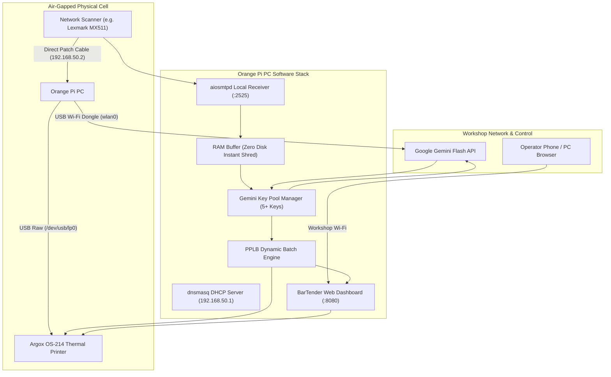

# Auto-Label Orchestrator 🏷️⚡

> **Edge AI Multi-Workflow Thermal Label Printing Station**  
> *Transforming Scanned Paper Invoices & Pick-and-Pack Sheets into Instant Continuous Argox PPLB Print Runs via Orange Pi & Gemini Flash Vision.*

[](LICENSE)
[]()
[-orange.svg)]()
[-yellow.svg)]()
[-brightgreen.svg)]()
[-teal.svg)]()

---

## 📌 Project Status: Work In Progress (WIP)

> [!NOTE]
> **Current Milestone**: Software Core, In-Memory SMTP Receiver, Gemini Key Pool Manager, PPLB Generator, and Web Dashboard are **100% built and validated** against the virtual simulation test bench. Live bench testing with the physical scanner and Argox OS-214 printer is scheduled for the upcoming workshop testing session.

---

## 📖 Executive Summary & Problem Solved

In high-volume printer cartridge manufacturing, refilling, and distribution facilities, workshop operators process dozens of paper orders daily. Staff must manually examine handwritten notes on printed quotes, identify requested cartridges, decipher messy handwriting, and manually re-enter order details into desktop BarTender software to print individual cartridge and outer carton labels.

Typing 30+ outer box labels and dozens of cartridge stickers by hand is the **single biggest operational bottleneck** on the factory floor, causing delays, typos, and costly label waste.

**Auto-Label Orchestrator** automates this end-to-end on an affordable, energy-efficient **Orange Pi PC (Allwinner H3, 1GB RAM)**:
1. **1-Touch Scan**: The operator loads a quote sheet or packing slip into the document feeder of any network scanner and taps a single touchscreen shortcut.
2. **Direct Isolated Transmission**: The scanner pushes the PDF directly over an air-gapped Ethernet cable to a local SMTP daemon on the Orange Pi.
3. **Confidential In-Memory AI Extraction**: The Orange Pi holds the document strictly in volatile RAM, queries a free-tier **Google Gemini Flash** key pool to extract marked items and handwriting, and immediately executes a **Zero-Shred protocol** (`0x00` wipe + garbage collection) to ensure confidential customer data is never written to disk.
4. **Native Continuous Printing**: The Orange Pi injects the extracted batch quantities (e.g. `P30`) directly into native PPLB `.prn` files and streams them over raw USB (`/dev/usb/lp0`) to the **Argox OS-214 thermal transfer printer**, running off entire batches continuously without needing any x86/x64 PC.

---

## 🌐 Universal Scanner Compatibility

> [!TIP]
> **Scanner Agnostic**: While our reference build and testing bench utilize the **Lexmark MX511** (chosen for its widespread commercial availability, rock-solid automatic document feeder, and affordable secondary market pricing), **this system is completely universal**.
>
> Any desktop, multifunction, or commercial scanner capable of **Scan-to-Email (SMTP)** or **Network Folder (SMB/FTP)** push (such as Canon, HP, Brother, Xerox, Ricoh, Epson, or Kyocera) works out of the box with zero code changes. Simply point your scanner's primary SMTP gateway to the Orange Pi's IP address on port `2525`.

---

## 🚀 Key Software Capabilities

* **Dual-Workflow Automatic Classifier**:
  * **Workflow A (Quotation / Tax Invoice $\rightarrow$ Cartridge Labels)**: Identifies printed table rows marked with a handwritten circle, tick, or 'X' $\rightarrow$ extracts row quantity (e.g. 10, 30, 100) $\rightarrow$ handles cross-brand cartridge annotations (e.g. `CB540A` marked as `Canon 716 Black` or `HCF` notes) $\rightarrow$ matches pre-made `.prn` templates on the SD card $\rightarrow$ rewrites print count to `P<Qty>` for continuous batch printing.
  * **Workflow B (Pick & Pack Sheet $\rightarrow$ Outer Box Labels)**: Parses Quote Number, Box Weight, and `Box X of Y` $\rightarrow$ itemizes contents, categorizing models as **Toner Unit** vs. **Drum / Imaging Unit** (e.g. `DR3115`, imaging drums) $\rightarrow$ calculates dynamic PPLB line coordinates $\rightarrow$ automatically prints **2 copies (`P2`)** for front and back carton placement.
* **Resilient Free-Tier Gemini Key Pool**: Rotates across 5+ free Gemini API keys, automatically detecting HTTP `429 RESOURCE_EXHAUSTED` and failing over in <500ms. Capped at `max_output_tokens=1024` with `temperature=0.0` for 100% free, deterministic operation under Google's 1,500 requests/day quota.
* **BarTender Web Dashboard & Smart Color Queue**: Responsive web UI served on port 8080. Intelligently groups pending labels by roll color (`Black`, `Cyan`, `Magenta`, `Yellow`) so operators only swap physical label rolls **once per color batch**.
* **Human-in-the-Loop Safeguard**: If an operator's handwriting is scribbled or ambiguous, the AI flags `requires_confirmation: true`, placing the job in an approval queue accessible from any phone or laptop on the local Wi-Fi.

---

## 🏗️ Hardware Architecture & Wiring Topology



### 1. Direct Network Interconnect (Scanner $\leftrightarrow$ Orange Pi)
* **Physical Connection**: Standard Cat5e/Cat6 patch cable directly connecting the scanner RJ45 port to the Orange Pi PC `eth0` port. (Auto-MDIX handles crossover automatically).
* **Isolated Subnet**: The Orange Pi runs a minimal `dnsmasq` DHCP service on `eth0` (`192.168.50.1/24`), leasing `192.168.50.2` to the scanner. The scanner is completely air-gapped from Wi-Fi.
* **Internet Uplink for Gemini**: A small USB Wi-Fi dongle on the Orange Pi (`wlan0`) provides internet access exclusively for Gemini Flash API requests.

### 2. Printer Interface (Orange Pi $\leftrightarrow$ Argox OS-214)
* **Physical Connection**: Standard USB Type-A to Type-B cable connecting Orange Pi USB to Argox rear port.
* **Driverless Raw USB**: Exposes Linux character device node `/dev/usb/lp0`. The Orange Pi's 32-bit ARM CPU writes native PPLB binary text directly to the printer with zero driver overhead.

---

## 🗂️ Project Directory Structure

```text
auto_label_orchestrator/
├── .env.example                  # Environment variables & Gemini key pool template
├── .gitignore                    # Ignores sensitive tokens, virtualenvs, cache
├── LICENSE                       # MIT License
├── README.md                     # Comprehensive engineering specification & guide
├── requirements.txt              # Lightweight dependencies for 1GB RAM SBC
├── daemon/
│   ├── __init__.py
│   ├── config.py                 # Cross-platform config loader (.env + fallbacks)
│   ├── gemini_pool.py            # Multi-key pool manager with automatic 429 failover
│   ├── classifier.py             # Dual-workflow AI prompt & Pydantic schemas
│   ├── smtp_receiver.py          # aiosmtpd listener with 0x00 memory shredder
│   ├── printer_engine.py         # Argox PPLB driver with dynamic P<Qty> batching
│   ├── color_queue.py            # Smart roll-color queue manager
│   ├── web_ui.py                 # aiohttp REST API & BarTender-style web server
│   └── main.py                   # Central async orchestrator service
├── web/
│   └── index.html                # Responsive BarTender Web GUI
├── templates/
│   └── sample_labels/            # Pre-made PPLB (.prn) label library
│       ├── Dell_HCF_283x.prn
│       ├── CB540A_BLACK.prn
│       ├── CANON_716_BLACK.prn
│       ├── CB541A_CYAN.prn
│       └── DR3115_DRUM.prn
├── scripts/
│   ├── setup_direct_ethernet.sh  # Sets up eth0 static IP & dnsmasq on Armbian
│   └── install_service.sh        # Installs systemd background service
├── systemd/
│   └── autolabel.service         # Systemd unit file with 350MB RAM sandbox
├── simulator/
│   ├── mock_lexmark.py           # Synthetic scanner email transmission
│   └── mock_argox.py             # Virtual Argox thermal printer & ASCII visualizer
└── tests/
    └── test_e2e.py               # Automated unit & integration test suite
```

---

## ⚙️ Installation & Deployment

### 1. Preparing the 8GB MicroSD Card
Flash **Armbian Minimal (Headless CLI, Debian/Ubuntu base)** onto the 8GB MicroSD card using BalenaEtcher or Raspberry Pi Imager.

### 2. Deploying on Orange Pi PC
Once the Orange Pi is powered on and connected to your Wi-Fi:
```bash
git clone https://github.com/kylerichter36-coder/auto-label-orchestrator.git
cd auto-label-orchestrator

# Configure direct isolated Ethernet link for the scanner
sudo ./scripts/setup_direct_ethernet.sh

# Install dependencies and systemd service
sudo ./scripts/install_service.sh
```

### 3. Adding Your Free Gemini Keys
Edit `/opt/label_system/.env`:
```env
GEMINI_API_KEYS=AIzaSyA_KEY1,AIzaSyB_KEY2,AIzaSyC_KEY3,AIzaSyD_KEY4,AIzaSyE_KEY5
PRINTER_DEVICE=/dev/usb/lp0
SIMULATION_MODE=false
```

---

## 🖨️ Reference Scanner Configuration (Lexmark MX511)

1. Plug the Ethernet cable directly from the scanner to the Orange Pi.
2. The Orange Pi automatically assigns IP `192.168.50.2` to the scanner.
3. In a web browser on any device connected to the network, access `http://192.168.50.2`:
   * **Settings $\rightarrow$ Network/Ports $\rightarrow$ TCP/IP**: Ensure DHCP is set to Automatic.
   * **Settings $\rightarrow$ E-mail / FTP $\rightarrow$ E-mail Setup**:
     * Primary SMTP Gateway: `192.168.50.1`
     * SMTP Port: `2525`
     * Authentication: `None / Anonymous`
     * SSL/TLS: `Disabled`
     * Device E-mail Address: `scanner@local`
4. **Create a 1-Touch Home Screen Shortcut**:
   * Name: `Label Scanner`
   * Destination: `quotes@orangepi.local`
   * Format: `PDF`
   * Resolution: `300 DPI`
   * Color: `Color (24-bit)`

---

## 🧪 Virtual Test Bench (Testing Without Hardware)

You can run and test the complete system on any laptop today before connecting physical hardware:

```bash
# 1. Run the automated test suite
python tests/test_e2e.py

# 2. Launch the orchestrator in simulation mode
python -m daemon.main

# 3. Open the BarTender Web Dashboard in your browser:
# http://localhost:8080

# 4. In a separate terminal, trigger a simulated scan:
python simulator/mock_lexmark.py
```

---

## 📅 Roadmap & TODOs

### Phase 1: Software Foundation & Simulation [COMPLETED]
- [x] In-memory local SMTP server with RFC 5322 MIME extraction.
- [x] Instant Confidential Shredder (`0x00` buffer zeroing + garbage collection).
- [x] Resilient Gemini Free-Tier Key Pool with automatic HTTP 429 failover.
- [x] Dual-workflow classifier (Quote vs. Pick & Pack) with toner cross-referencing.
- [x] Native Argox PPLB batch generator with dynamic `P<Qty>` injection.
- [x] Dynamic outer box PPLB generator with automatic 2x copies (`P2`).
- [x] BarTender Web dashboard with smart color queues (Black, Cyan, Magenta, Yellow).
- [x] Virtual scanner and Argox hardware simulators.
- [x] Automated test suite passing 100%.

### Phase 2: Live Workshop Bench Testing [IN PROGRESS]
- [ ] Connect Lexmark MX511 via direct patch cable and verify automatic DHCP lease (`192.168.50.2`).
- [ ] Test 1-touch touchscreen scan from scanner to Orange Pi port 2525.
- [ ] Connect Argox OS-214 via USB and verify native `/dev/usb/lp0` binary transmission.
- [ ] Conduct live scan tests with 10 actual customer quote sheets.
- [ ] Calibrate outer box label print boundaries on physical 4x6" thermal stock.

### Phase 3: Electromechanical Multi-Roll Feeder [FUTURE EXPANSION]
- [ ] Construct 2020 aluminum extrusion rear feeder frame behind Argox external media slot.
- [ ] 3D-print converging 4-channel Y-manifold for Black, Cyan, Magenta, and Yellow rolls.
- [ ] Mount NEMA 17 stepper motors and TCRT5000 optical sensors for automated media switching.
- [ ] Connect stepper drivers to Arduino Nano / RP2040 sub-controller over USB serial.
- [ ] Upgrade web software to command automated roll switching instead of manual prompts.

---

## 📄 License

Distributed under the [MIT License](LICENSE).
